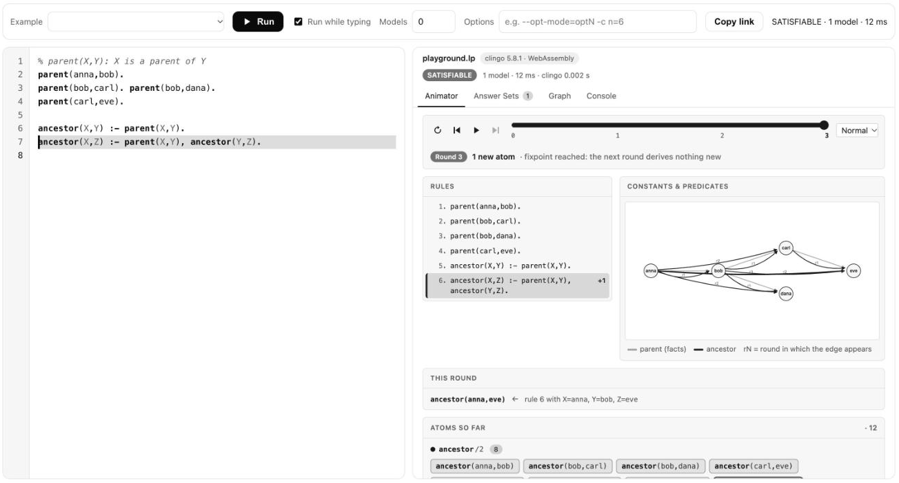

# ASP Studio

[](https://pypi.org/project/asp-studio/)
[](https://pypi.org/project/asp-studio/)
[](https://github.com/yakupbulbul/asp-vscode/actions/workflows/ci.yml)
[](LICENSE)

ASP Studio runs [clingo](https://potassco.org/clingo/) on your Answer Set Programming files and shows what comes out: the answer sets, a graph of the atoms, and a step-by-step view of how a recursive program reaches its result. It is a VS Code extension, a Python package for notebooks and the command line, and a playground that runs in the browser.

[Playground](https://yakupbulbul.github.io/asp-vscode/playground.html) · [Website](https://yakupbulbul.github.io/asp-vscode/) · [Documentation](https://yakupbulbul.github.io/asp-vscode/docs.html) · [Releases](https://github.com/yakupbulbul/asp-vscode/releases) · [PyPI](https://pypi.org/project/asp-studio/)

<p align="center">
  <picture>
    <source media="(prefers-color-scheme: dark)" srcset="docs/assets/screenshot-dark.png">
    
  </picture>
</p>

## Contents

- [Ways to use it](#ways-to-use-it)
- [What it does](#what-it-does)
- [Install the VS Code extension](#install-the-vs-code-extension)
- [First steps](#first-steps)
- [Setting up tools](#setting-up-tools)
- [Animator limits](#animator-limits)
- [Commands, keys and settings](#commands-and-keys)
- [Notebooks and Python](#notebooks-and-python)
- [Questions](#questions)
- [Development](#development)

## Ways to use it

| You want to | Use |
|---|---|
| Try it without installing anything | the [playground](https://yakupbulbul.github.io/asp-vscode/playground.html) |
| Work on `.lp` files in an editor | the VS Code extension, from the [latest release](https://github.com/yakupbulbul/asp-vscode/releases/latest) |
| Use it in Jupyter or a VS Code notebook | `pip install "asp-studio[notebook]"` |
| Get a report from a script or CI job | `asp-studio program.lp`, which writes a standalone HTML file |

## What it does

- Solves the active `.lp` file with clingo, either while you type or on demand. Answer sets are grouped by predicate, and optimization costs show on the card.
- Steps through the derivation of a positive program, one round at a time. Each round lists the new atoms, the rule that produced each one and its variable bindings.
- Highlights the rules that fired in the current round in your editor, with a note like `← round 2: +3 atoms`. Clicking a rule in the panel jumps to its line.
- Draws atoms with two arguments, such as `edge(a,b)`, as a graph. You can switch between answer sets, hide predicates and drag nodes.
- Turns clingo's errors into editor squiggles and Problems entries. When a program spans several files, each message points at the file it came from.
- Uses a native clingo if it finds one. Otherwise it runs a bundled WebAssembly build of clingo 5.8, so a fresh machine works without setup.

ASP Studio does not provide syntax highlighting. Any ASP highlighter extension works alongside it, and the setup command below can install one.

## Install the VS Code extension

Download `asp-studio-<version>.vsix` from the [latest release](https://github.com/yakupbulbul/asp-vscode/releases/latest), then run

```bash
code --install-extension asp-studio-<version>.vsix
```

or open the Extensions view, choose **… → Install from VSIX…** and pick the file. It works on macOS, Windows and Linux and needs VS Code 1.85 or newer.

To build it yourself:

```bash
git clone https://github.com/yakupbulbul/asp-vscode.git
cd asp-vscode
npm install
npm run package
code --install-extension asp-studio-*.vsix
```

## First steps

1. Open a `.lp` file.
2. Click the graph icon in the editor title bar, or run **ASP: Open Visualizer** from the Command Palette. The panel opens beside your file.
3. Edit the program. The panel updates when you stop typing. Press **Solve** (`⌘⌥Enter`, or `Ctrl+Alt+Enter`) to compute every answer set.

```prolog
parent(anna,bob). parent(bob,carl). parent(carl,eve).
ancestor(X,Y) :- parent(X,Y).
ancestor(X,Z) :- parent(X,Y), ancestor(Y,Z).
```

Open the Animator tab and press Step. Round 0 holds the facts, round 1 adds the direct ancestors, rounds 2 and 3 add the longer chains, and the iteration stops when nothing new can be derived. That last state is the fixpoint.

## Setting up tools

Run **ASP: Set Up Environment…** to see what is installed and choose what to add. Nothing is downloaded until you confirm.

| Component | What happens |
|---|---|
| Native clingo | `pip install clingo` into a private Python environment in the extension's storage folder. It is found automatically and runs as `python -m clingo`. Needs Python 3.8 or newer. |
| Syntax highlighting | Installs the Marketplace extension `abelcour.asp-syntax-highlight`. |
| viASP | `pip install viasp` into the same environment, about 60 MB with its dependencies. **ASP: Open viASP for Current File** then starts it. |

Nothing outside the extension's storage folder changes. **ASP: Remove Private Environment** deletes it again. If only the WebAssembly clingo is available, the extension offers this setup once.

## Animator limits

The animator follows positive programs: facts and rules without `not`. It rejects negation, choice rules `{ ... }`, constraints `:- ...` and ranges `1..n`, and the message names the line. For such programs the Answer Sets, Graph and Console tabs still work.

## Commands and keys

| Command | Default key |
|---|---|
| ASP: Open Visualizer | editor title icon |
| ASP: Solve Current File | `⌘⌥Enter` or `Ctrl+Alt+Enter` |
| ASP: Animator: Step Forward / Back | `Ctrl+Alt+→` / `Ctrl+Alt+←` |
| ASP: Animator: Play / Pause | `Ctrl+Alt+Space` |
| ASP: Animator: Reset to Round 0 | |
| ASP: Set Up Environment… | |
| ASP: Open viASP for Current File | |
| ASP: Select clingo Executable… | |
| ASP: Remove Private Environment | |
| ASP: Open Settings | |
| ASP: Show Output Log | |

Inside the panel, `←` and `→` step, `Space` plays or pauses and `R` resets.

### Settings

| Setting | Default | Meaning |
|---|---|---|
| `asp.clingoPath` | `""` | Path to a native clingo. Empty means auto-detect, then WebAssembly. |
| `asp.preferWasm` | `false` | Always use the bundled WebAssembly clingo. |
| `asp.models` | `0` | Maximum number of answer sets (0 means all). |
| `asp.options` | `[]` | Extra clingo options, for example `["--opt-mode=optN", "-c", "n=6"]`. |
| `asp.timeoutSeconds` | `10` | Stops long computations. |
| `asp.scope` | `activeFile` | `folder` solves all `.lp` files in the folder together. |
| `asp.autoRun`, `asp.autoRunDelay` | `true`, `500` | Re-solve while the panel is open, after this many milliseconds of quiet. |
| `asp.autoRunMaxModels` | `50` | Model limit for auto-run when `asp.models` is 0. |
| `asp.runOnSave` | `true` | Check files on save and fill the Problems panel. |
| `asp.maxModelsShown` | `100` | Answer sets drawn in the panel. |
| `asp.animator.speed` | `1400` | Milliseconds per round while playing. |
| `asp.animator.highlightRules` | `true` | Highlight firing rules in the editor. |

The highlight colors are the theme colors `asp.activeRuleBackground` and `asp.activeRuleBorder`. Override them in `workbench.colorCustomizations`.

## Notebooks and Python

The Python package in [`python/`](python/) gives you the same panel in Jupyter and VS Code notebooks:

```bash
pip install "asp-studio[notebook]"
```

```text
%load_ext asp_studio
%%asp
parent(anna,bob). parent(bob,carl).
ancestor(X,Y) :- parent(X,Y).
ancestor(X,Z) :- parent(X,Y), ancestor(Y,Z).
```

It also has `asp_studio.solve()`, `asp_studio.show()` and an `asp-studio program.lp --open` command that writes a standalone HTML report. See [`python/README.md`](python/README.md).

## Questions

### Does my program leave my machine?

No. The extension runs clingo locally and the playground runs it in your browser as WebAssembly. The only network use is the optional setup command, and it downloads packages from PyPI and the Marketplace only after you confirm.

### Which clingo does it use?

A native one when it finds one: your setting first, then the private environment, `PATH`, conda and Homebrew. Otherwise the bundled WebAssembly build. The panel header says which one answered.

### Why does the animator say it cannot show my program?

The animator only follows positive programs, and the message names the first line it does not support. Answer Sets, Graph and Console still work for anything clingo accepts.

### Can I use several files?

Yes. Set `asp.scope` to `folder` and the extension solves every `.lp` file in the folder together. In Python, `solve` takes a list of files.

### How do I report a problem?

Open an [issue](https://github.com/yakupbulbul/asp-vscode/issues). The Output panel (channel "ASP Studio") and your VS Code and clingo versions help a lot. For a security problem, use private reporting instead, described in [SECURITY.md](SECURITY.md).

## Development

```bash
npm test                  # unit tests (node:test); the native-clingo tests skip if clingo is missing
npm run test:integration  # starts a real VS Code (set VSCODE_EXECUTABLE to use an installed one)
pytest python             # Python package tests
node scripts/preview.js   # renders the panel with real data into .preview/index.html
```

Press `F5` in VS Code to start an Extension Development Host. See [CONTRIBUTING.md](CONTRIBUTING.md) for the workflow.

The code is split like this: `src/` is the extension host, `media/` holds the panel UI and the fixpoint engine, `python/` is the notebook and command-line package, `docs/` is the website and playground and `vendor/` has the unmodified clingo-wasm 0.6.0 files. The panel files in `media/` are copied into `python/src/asp_studio/static` by `python/sync_static.py` and into `docs/assets/panel` by `scripts/sync_docs.py`. Tests fail if a copy drifts apart.

## License

MIT, see [LICENSE](LICENSE). The bundled clingo and clingo-wasm keep their own licenses, listed in [THIRD-PARTY-NOTICES.md](THIRD-PARTY-NOTICES.md). This project is not affiliated with the Potassco team.
