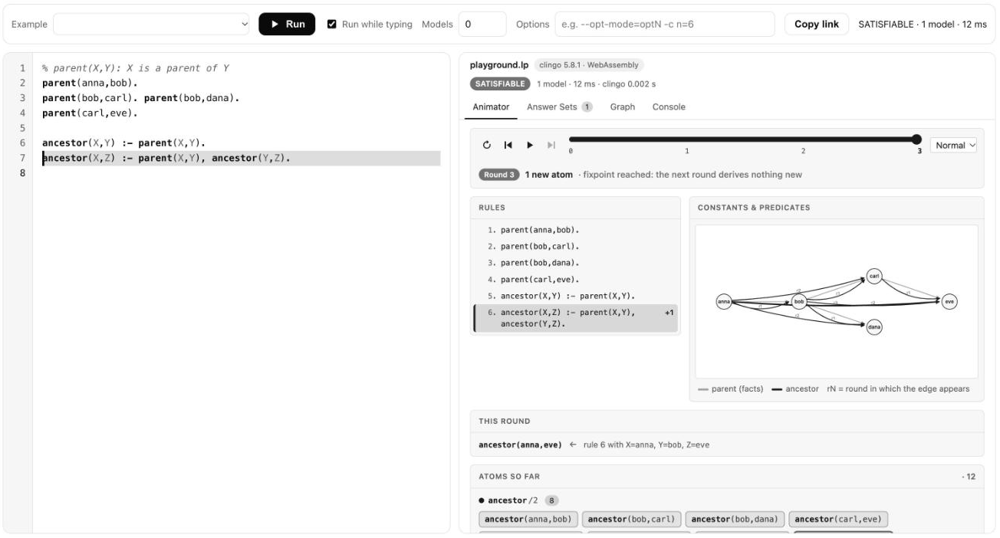

# ASP Studio for Python

[](https://pypi.org/project/asp-studio/)
[](https://pypi.org/project/asp-studio/)
[](https://github.com/yakupbulbul/asp-vscode/blob/main/LICENSE)

ASP Studio shows the answer sets of an [Answer Set Programming](https://potassco.org/) program, draws them as a graph, and steps through how a recursive program reaches its result. It works in Jupyter, in VS Code notebooks and from the command line. It uses the clingo Python API and shares its visualizer with the [ASP Studio VS Code extension](https://github.com/yakupbulbul/asp-vscode).

[Playground](https://yakupbulbul.github.io/asp-vscode/playground.html) · [Documentation](https://yakupbulbul.github.io/asp-vscode/docs.html) · [Source](https://github.com/yakupbulbul/asp-vscode) · [Issues](https://github.com/yakupbulbul/asp-vscode/issues)



```bash
pip install "asp-studio[notebook]"      # Python 3.9 or newer
```

The `notebook` extra adds IPython for the `%%asp` magic. Without it you still get `solve()` and the command line.

## In a notebook

```python
%load_ext asp_studio
```

```text
%%asp
parent(anna,bob). parent(bob,carl). parent(carl,eve).
ancestor(X,Y) :- parent(X,Y).
ancestor(X,Z) :- parent(X,Y), ancestor(Y,Z).
```

The output has four tabs. Animator steps through the rounds and shows which rule fired with which variable bindings. Answer Sets lists every model. Graph draws the atoms. Console shows clingo's messages and the position of any error.

Cell options:

| Option | Meaning |
|---|---|
| `-n 5`, `--models 5` | At most 5 answer sets (0 means all). |
| `-o "--opt-mode=optN -c n=6"` | Extra clingo options. A value that starts with a dash is fine. |
| `-t 20` | Timeout in seconds. The default is 10. |
| `--tab answers` | First tab to show: `animator`, `answers`, `graph` or `console`. |
| `--theme dark` | `auto` (default), `light` or `dark`. Inside VS Code the editor theme is used. |
| `--height 500` | Starting height in pixels. The output grows with its content. |
| `--out res` | Keep the result in a variable called `res`. |

## From Python

```python
import asp_studio as asp

res = asp.solve("a :- not b. b :- not a.", models=0, timeout=10)
res.result          # 'SATISFIABLE'
list(res)           # [['b'], ['a']]
res.diagnostics     # positions of errors and warnings from clingo
res                 # as the last line of a cell: shows the visualizer
asp.show(res, tab="graph")
```

`solve` takes ASP text, a `pathlib.Path`, a `(name, text)` pair, or a list of those, which are joined in order. A broken program does not raise: check `res.ok` and `res.error`. Diagnostics carry the name of the file they came from. With `#minimize` or `#maximize` and a finished search, only the optimal models are kept, and their costs are in `res.costs`.

| Attribute | Meaning |
|---|---|
| `res.ok`, `res.error` | Whether the program ran, and why not. |
| `res.result` | `SATISFIABLE`, `UNSATISFIABLE`, `OPTIMUM FOUND` or `UNKNOWN`. |
| `res.models`, `res.costs` | The answer sets as lists of atom strings, and their costs. |
| `res.more` | True if you limited the models and more exist. |
| `res.diagnostics` | `Diagnostic(file, line, col, severity, message)` entries. |
| `res.ms`, `res.time` | Wall-clock milliseconds, and clingo's own total time. |

## Command line

```bash
asp-studio program.lp --open                # writes program.html and opens it
asp-studio instance.lp encoding.lp -n 3     # several files are joined in order
cat program.lp | asp-studio - --out report.html   # read standard input
asp-studio program.lp -o --opt-mode=optN    # extra clingo options
asp-studio --version
```

| Option | Meaning |
|---|---|
| `-n`, `--models` | At most this many answer sets (0 means all). |
| `-o`, `--options` | Extra clingo options. |
| `-t`, `--timeout` | Timeout in seconds. The default is 10. |
| `--out` | Output file, or a directory. The default is `<first file>.html`. |
| `--tab`, `--theme` | First tab and color theme of the report. |
| `--open` | Open the report in your browser. |

The exit code is 0 when the program ran, 1 when it has an error (positions print as `file:line:col`) and 2 for bad arguments or unreadable input. `python -m asp_studio` does the same without the script on `PATH`.

## Notes

- The animator follows positive programs only: no `not`, choice rules, constraints or ranges. For other programs it names the unsupported line, and the other three tabs still work.
- The visualizer runs in an isolated `<iframe>`. Jupyter shows such output only in trusted notebooks.
- Outside notebooks and VS Code, the color theme follows the operating system.

## Development

```bash
pip install -e ".[test]"
pytest
python sync_static.py     # copy ../media/{engine.js,webview.js,webview.css,themes.css} into the package
```

The visualizer files live in `../media` and are copied into `src/asp_studio/static`. A test fails when the copies drift apart.

MIT license. Not affiliated with the Potassco team.
